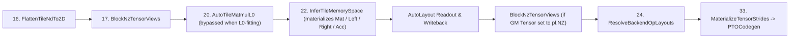

# 11. Automatic Layout Selection

This document describes the design, pipeline placement, solver instance extraction/writeback, and cost-model calibration framework for automatic layout selection (`pypto.ir.auto_layout`) in PyPTO, building on the formal model of *Tensor Seeks Layout: Formalizing Layout Selection for ML Compilers* (Eisenhofer et al., arXiv:2608.21555).

---

## 1. Motivation & Existing Mechanisms

PyPTO represents layouts at two distinct levels of the Ascend memory hierarchy:

1. **Global Memory (GM / `DDR`) Tensors (`pl.Tensor`)**:
   - `TensorLayout`: `ND` (row-major), `DN` (col-major), `NZ` (fractal blocked `[..., C/c0, R/16, 16, c0]` where `c0 = 32 / sizeof(dtype)`), and `MX_*` block-scale formats.
2. **On-Chip Tiles (`pl.Tile`)**:
   - `TileView(blayout, slayout, fractal)` paired with `MemorySpace` (`Vec` / UB, `Mat` / L1, `Left` / L0A, `Right` / L0B, `Acc` / L0C, `Bias`):
     - `ROW_MAJOR_FLAT = (row_major, none_box, 512)` / `COL_MAJOR_FLAT = (col_major, none_box, 512)` in `Vec` (UB)
     - `FRACTAL_NZ = (col_major, row_major, 512)` in `Mat` (L1) and `Left` (L0A)
     - `FRACTAL_ZN = (row_major, col_major, 512)` in transposed `Mat` (L1) and `Right` (L0B)
     - `FRACTAL_ACC_NZ = (col_major, row_major, 1024)` in `Acc` (L0C)

Prior to automatic layout selection, PyPTO handled layouts via local or declarative passes:

| Pass | Role | Scope |
|---|---|---|
| [`BlockNzTensorViews`](passes/17-block_nz_tensor_views.md) (Pass 17) | Rewrites tensors already declared `pl.NZ` into rank-5 `[B, C/c0, R/16, 16, c0]` views and retargets `tile.load` / `tile.store` coordinates. | Implements a chosen `pl.NZ` annotation; does not choose between `ND` and `NZ`. |
| [`InferTileMemorySpace`](passes/22-infer_tile_memory_space.md) (Pass 22) | Infers `MemorySpace` (`Vec`, `Mat`, `Left`, `Right`, `Acc`), inserts `tile.move` ops into L0A/L0B, and assigns default `TileView` layouts per space. | Local propagation from operator constraints. |
| [`ResolveBackendOpLayouts`](passes/24-resolve_backend_op_layouts.md) (Pass 24) | Locally wraps non-`row_major` elementwise operands in `tile.reshape` or `tile.move` and restores the original layout after each op. | Single-operator legalization. |

---

## 2. Pipeline Placement (After `AutoTileMatmulL0` and `InferTileMemorySpace`)

To observe and choose layouts for **both** GM tensors (`DDR`) and on-chip L1/UB/L0 tiles (`Mat`, `Vec`, `Left`, `Right`, `Acc`), the layout pass is positioned **after `AutoTileMatmulL0` (Pass 20) and `InferTileMemorySpace` (Pass 22)**, and **before `ResolveBackendOpLayouts` (Pass 24)**:



### Why This Slot?

1. **L0 Tiles Exist Only After Pass 20 / Pass 22**:
   - Before `AutoTileMatmulL0` (Pass 20) and `InferTileMemorySpace` (Pass 22), L0 (`Left`, `Right`, `Acc`) tiles and the `Mat -> Left` / `Mat -> Right` `tile.move` operations are not yet materialized in the IR.
   - Immediately after `InferTileMemorySpace` (Pass 22), every GM parameter (`DDR`), every L1/UB tile (`Mat`, `Vec`), and every L0 tile (`Left`, `Right`, `Acc`) is an explicit SSA variable with a resolved `MemorySpace`.
2. **Decoupling from `AutoTileMatmulL0`**:
   - When matmul operand shapes already fit in L0A (64 KiB), L0B (64 KiB), and L0C (128 KiB) — for example `64x128 @ 128x64` in FP16 $\to$ FP32 (16 KiB each) — `AutoTileMatmulL0` is a **complete no-op** (`(m, n, k) == (M, N, K)`).
   - This lets us evaluate and calibrate the layout cost model cleanly without any coupling to `AutoTileMatmulL0` or `ChooseL0Tile`.
3. **Writing Back GM `pl.NZ` After Pass 22**:
   - When layout writeback assigns `pl.NZ` to a GM `Tensor` parameter after Pass 22, running `BlockNzTensorViews` (`run_post_layout_passes`) blocks the newly tagged `pl.NZ` tensor into its rank-5 `[1, C/c0, R/16, 16, c0]` view before `MaterializeTensorStrides` (Pass 33) and `PTOCodegen` run.
4. **Making `ResolveBackendOpLayouts` (Pass 24) a Guaranteed No-Op**:
   - `LayoutCostModel` and `extract_layout_instance` query the active C++ `Backend` (`pypto_core.backend.get_input_tile_layout`, `BackendHandler.get_pto_target_arch`) so only backend-legal `OperatorConfig`s are generated (e.g., `RowMajorOps()` constrained to `row_major`, `Mat -> Left/Right` constrained to legal MTE1 fractal layouts, `Acc -> NZ` store restricted to A2/A3 `Ascend910`).
   - Because every candidate `LayoutAssignment` already satisfies `BackendTileLayoutSpec`, downstream `ResolveBackendOpLayouts` (Pass 24) is a verified structural no-op.

---

## 3. Formal Problem & Cost Model Calibration

Following Eisenhofer et al. (arXiv:2608.21555), let $G = (V, E)$ be the kernel dataflow graph where each operation $o \in V$ has a set of admissible layout configurations $Q_o$. Choosing $q_o \in Q_o$ fixes:

- the required layout $\text{req}(o, i)$ for each input operand $i$,
- the produced layout $\text{prod}(t)$ for its output value $t$, and
- the operator execution cost $C^{\text{op}}_o(q_o)$.

For any value $t \in \mathcal{T}$ (in GM, L1, UB, or L0), let $\text{cons}(t)$ be the set of **distinct** layouts requested across all consumers of $t$. Conversion to each distinct layout $\ell \in \text{cons}(t)$ is charged once:

$$
\min_{\{q_o \in Q_o\}} \left[
  \sum_{o \in V} R_o \cdot C^{\text{op}}_o(q_o)
  + \sum_{t \in \mathcal{T}} \sum_{\ell \in \text{cons}(t)} C^{\text{tr}}_t\bigl(\text{prod}(t), \ell\bigr)
\right]
$$

### Calibratable Cost Components (`LayoutCostModel`)

`LayoutCostModel` exposes explicit cycle-level parameters for each stage of a matmul kernel so they can be calibrated against simulator or hardware measurements:

1. **GM $\to$ L1/UB Load (`estimate_load_cost`)**:
   - `ND -> Mat` (`TLoadGm2L1Nd2nz`): strided C0-line gather bandwidth (`mte2_nd2nz_bytes_per_cycle`) + per-row C0-block stride penalty (`mte2_nd2nz_row_penalty_cycles`).
   - `NZ -> Mat` (`TLoadGm2L1Nz2nz`): contiguous fractal burst bandwidth (`mte2_nz2nz_bytes_per_cycle`).
   - `ND -> Vec`: contiguous UB transfer (`mte2_vec_bytes_per_cycle`).
2. **L1 (`Mat`) $\to$ L0 (`Left` / `Right`) Move (`estimate_move_cost`)**:
   - MTE1 transfer (`mte1_l1_to_l0_bytes_per_cycle`) + optional layout-conversion penalty (`mte1_transpose_penalty_cycles`) when source and destination `TileLayoutDesc` differ.
3. **L0 Cube Matmul (`estimate_matmul_cost`)**:
   - `cube_issue_overhead_cycles + (M * N * K) / cube_macs_per_cycle`.
4. **L0C (`Acc`) $\to$ GM Store (`estimate_store_cost`)**:
   - `Acc -> ND` (`fixpipe_acc_to_nd_bytes_per_cycle`) vs. `Acc -> NZ` (`fixpipe_acc_to_nz_bytes_per_cycle`).
5. **Conversion / Packing Cost (`estimate_conversion_cost`)**:
   - GM `ND <-> NZ`: `gm_pack_fixed_cycles + bytes / gm_pack_bytes_per_cycle` (charged once for reusable weights, or per invocation $R$ for streaming tensors).
   - On-chip `tile.move` relayout: `bytes / onchip_relayout_bytes_per_cycle`.

---

## 4. Solvers & Treewidth Diagnostics (`pypto.ir.auto_layout_solver`)

`pypto.ir.auto_layout_solver` implements the paper's layout selection algorithms on top of `LayoutProblemInstance`:

1. **`solve_greedy(instance, *, initial=None, config=None) -> LayoutSolverResult`** (Section 4.1):
   - Initializes operations in topological dataflow order (greedily minimizing local operator + already-live input conversion costs) and then performs deterministic coordinate-descent sweeps over all movable operations (`|Q_o| > 1`) using exact incremental gain accounting (`_State.gain` / `_State.apply`).
2. **`compute_treewidth(instance) -> TreewidthStats`**:
   - Computes min-fill tree decompositions and reports:
     - `dataflow_treewidth`: treewidth of the producer-consumer DAG (ignoring co-consumer cliques on shared GM inputs),
     - `primal_treewidth`: treewidth of the full primal factor graph (where operations sharing a value form a clique),
     - `active_primal_treewidth`: treewidth of the primal subgraph induced by movable operations (`|Q_o| > 1`),
     - `max_bag_domain_product` and `total_dp_states`: exact state-space size $\sum_k \prod_{u \in B_k} |Q_u|$ for dynamic programming.
3. **`solve_treewidth_dp(instance, *, config=None) -> LayoutSolverResult`** (Section 4.2):
   - Exact bottom-up dynamic programming + top-down backpointer reconstruction over a rooted min-fill tree decomposition of the active primal graph.
   - Assigns each operator unary factor $\theta_u(q_u)$ and each shared-value conversion hyperedge $\psi_t(q_{N(t)})$ to the unique highest bag containing its scope, guaranteeing the global minimum of the paper's objective (including across shared-conversion barriers where single-operation greedy flips are locally unprofitable).

```python
from pypto.backend import BackendType, set_backend_type
from pypto.ir.auto_layout import (
    LayoutCostModel,
    apply_layout_assignment,
    extract_layout_instance,
    run_post_layout_passes,
    run_pre_layout_passes,
)
from pypto.ir.auto_layout_solver import (
    compute_treewidth,
    solve_greedy,
    solve_treewidth_dp,
)
from pypto.pypto_core import passes

set_backend_type(BackendType.Ascend910)
with passes.PassContext([], memory_planner=passes.MemoryPlanner.PYPTO):
    # 1. Run passes 1..22 (up through InferTileMemorySpace)
    pre_prog = run_pre_layout_passes(MatmulL0Fitting)

    # 2. Read out the solver instance (GM tensors + L1 tiles + L0 tiles + ops)
    instance = extract_layout_instance(
        pre_prog,
        cost_model=LayoutCostModel(expected_uses=100),
        reusable_tensors={"w"},
    )

    # 3. Inspect treewidth & solve (greedy heuristic or exact treewidth DP)
    tw_stats = compute_treewidth(instance)
    greedy_res = solve_greedy(instance)
    exact_res = solve_treewidth_dp(instance)

    # 4. Write the chosen assignment back into the IR and finish lowering
    rewritten = apply_layout_assignment(pre_prog, exact_res.writeback_assignment())
    lowered = run_post_layout_passes(rewritten)
```

### Pass-Manager Insertion & Calibration Harness (`auto_layout_bench`)

`ir.compile(..., layout_pass=...)` and `PassManager.get_strategy(..., layout_pass=...)` inject a custom pass (for example `lambda: make_auto_layout_pass(exact_res.writeback_assignment())`) immediately after `InferTileMemorySpace` and before `BlockNzTensorViews` / `ResolveBackendOpLayouts`.

To enumerate all legal design-space variants, compile them end-to-end (exporting `manifest.json` + `.pto` + runtime artifacts), benchmark them on Ascend A2 (`a2a3`), and fit `LayoutCostModel`:

```bash
# Compile-only variant enumeration & IR/.pto check (no device needed)
python -m pypto.ir.auto_layout_bench --compile-only --output-dir build_output/auto_layout_calib

# On-device Ascend A2 accuracy check, benchmarking, and linear cost-model fitting
python -m pypto.ir.auto_layout_bench --platform a2a3 --device 0 --rounds 100 --swimlane --output calib_results.json
```

Programmatic entry points live in `compile_layout_variants(...)` and `fit_cost_model_from_measurements(...)` (`pypto.ir.auto_layout`).

---

## 5. Roadmap

- **Step 0 (Completed)**: Build environment and C++ `pypto_core` setup.
- **Step 1 (Completed)**: Post-`InferTileMemorySpace` instance extraction (`extract_layout_instance`), assignment writeback (`apply_layout_assignment`) covering GM (`DDR`), L1 (`Mat`), and L0 (`Left`, `Right`, `Acc`), backend-legal enumeration, and decoupled `LayoutCostModel` evaluation (`evaluate_assignment`, `enumerate_assignments`) on L0-fitting matmul kernels.
- **Step 2 (Completed)**: End-to-end variant emission (`compile_layout_variants`), `PassManager`/`ir.compile` `layout_pass` integration, Ascend 910B2 (`a2a3`) 13-case / 124-variant hardware calibration campaign, and within-case demeaned differential regression (`fit_cost_model_from_measurements`) achieving `+0.9222` within-case Spearman rank correlation.
- **Step 3 (Completed)**: Greedy coordinate-descent solver (`solve_greedy`), treewidth diagnostics (`compute_treewidth`), and exact treewidth dynamic programming solver (`solve_treewidth_dp`) validated across calibration and production `pypto-lib` kernels.
