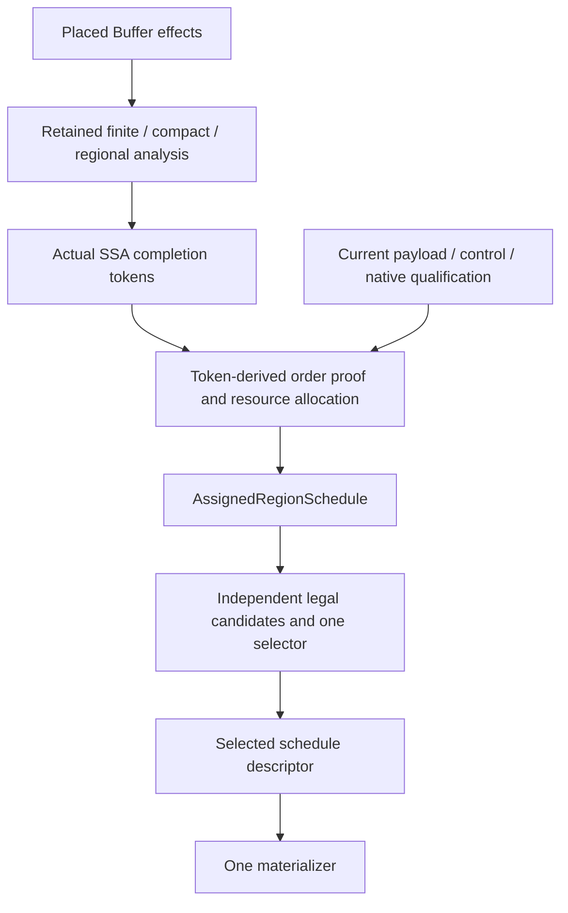

# Synchronization architecture correction

This checkpoint separates the accepted architecture from implementation and
qualification evidence. The starting checkout is `868fdd471` plus existing
uncommitted regional-scheduling work. A commit ID alone does not identify that
baseline. The earlier [regional receipt](regional-sync-schedules.json) remains
a record of its own measured implementation; its acceptance does not establish
that the corrections described here are complete.

The [correction receipt](sync-schedule-architecture-correction.json) records
each subsequent gate. Stages 1–4 are implemented and independently accepted
within their recorded scopes. Host checks and emitted code are not device evidence.

## Architecture and authority

Insertion derives dependencies from the admitted effect model. Lowering instead
interprets the actual SSA token definitions and uses. It must not regenerate
storage demands to replace an edited or manually supplied protocol. Native
qualification remains necessary: a token does not establish a payload pipe,
descriptor layout, coordinate readiness, target variant or resource reservation.

Allocation retains the distinction between an immutable, non-consuming logical
completion fact and a consuming physical notification. Its event assignments,
reuse proofs and complete invocation domains are inputs to scheduling. Scheduling
does not recolor IDs, modify token dependencies, introduce native exemptions or
alter invocation entry/return guarantees.

Source-invariant inventory may be shared within one immutable transaction.
Independent `LowerSync` must derive caller facts from its current program.
Neither an insertion sidecar nor an old source snapshot authorizes lowering.

## Stage 1: ownership, errors and qualification

`CheckGeneratedLogicalSync` reports malformed insertion output as an internal
compiler error. Both standalone `InsertSync` and transactional `RealizeSync`
use this boundary. The latter cannot convert that failure to ordinary PTOAS
delegation. Standalone malformed user tokens retain validation diagnostics.
Supported qualification or resource refusals still preserve the original body.

`ImportSyncPayloads` is the token-lowering entry point for shared current-IR
qualification. It retains descriptor checks, placed local geometry, native
instruction/pipe admission, coordinate arithmetic and original slot-frame
checks. Geometry used to qualify extraction or native hardware behavior remains
checked. It does not construct the dependence-access inventory, GM alias
partition, physical interval exports or storage startup summaries. Actual token
order does not consume a storage exemption from those summaries.

Consequently, unused scalar formals need no range certificate, and unused tensor
formals need no dependence-model shape. A supported explicit-token program with
different GM invocation translations can lower even when insertion cannot prove
that access-model relation. This does not prove the completeness of a handwritten
protocol or broaden insertion's access admission. Scalar definitions and native
descriptors retain their existing conservative qualification.

The physical schedule materializer shares one function-owned name inventory
across all phase, residue and invocation-group copies. Constructing a copy no
longer rescans the entire original function to reserve names. The diagnostic
counters `schedule_name_scans` and `schedule_name_visits` make this source work
visible separately from emitted body copies.

Stage 1 validation includes:

- Finite and structured lowering with unused scalar/tensor parameters.
- Different GM translations, checked against independently interpreted actual
  tokens and physical flags; insertion still refuses the unsupported relation.
- Generated-output internal errors versus user-input validation errors.
- Retained placement refusal and shared name-inventory scaling.
- A serial rebuilt focused gate of 153 tests and a broader gate of 1,552 tests.
  The latter emitted 37 existing deprecation warnings. These are host checks.

The first focused attempt encountered six PTOAS loader failures; after selecting
the local PTOAS v0.72 package with its required Python interpreter, the final
focused gate passed. The receipt preserves this distinction rather than
counting the environment failures as compiler regressions or claiming an
unqualified first-attempt pass.

## Stages 2–3: independent candidates and complete selection

Stage 2 moves phase preparation, invocation grouping and boundary-motion planning
before materialization. The selected descriptor can now version the original
loop by invocation case even when all endpoints span the whole loop. The
regression uses unequal actual token uses in two cases and checks independent
access, token and physical-flag semantics, including the original nonunit step
and nondivisible stop. Its AIV launch bounds are supplied explicitly to the
production lowering entry point; it does not establish AIV caller recollection.
Existing AIC invocation tests cover that separate route.

The final rebuilt stage-2 focused gate passed 62 tests. An earlier regional,
boundary and AIC invocation gate passed 70 tests with four existing deprecation
warnings, before the diagnostic binding addition and formatting. Review checked
the six source hashes and extension hash against the pinned receipt. This accepts
the intermediate planning/materialization split, not the legacy B/P admission or
local savings policy. Case-only candidates whose baseline extracts boundary
commands remain conservatively deferred until stage 3 composes complete costs.

The accepted design requires a pure assigned-command inventory before planning.
Candidate construction must not depend on another optimization first being
profitable. In particular, invocation-case loop versioning must be considered
when there is no useful phase boundary and no periodic expansion.

The finite candidate catalogue crosses these four loop forms with two dispatch
forms:

| Loop form | Per-cut invocation dispatch | Invocation-case loop versioning |
| --- | --- | --- |
| Guarded original loop | Baseline | Case-only candidate |
| Boundary splitting | Boundary-only candidate | Case + boundary candidate |
| Periodic expansion | Periodic-only candidate | Case + periodic candidate |
| Boundary splitting and periodic expansion | Boundary + periodic candidate | Combined candidate |

Interval facts and optional ordinal-congruence facts are separate. A nonunit
assigned ID period must not prevent interval-only planning. Periodic-only
planning must preserve any endpoint guards it does not eliminate. The planner
must preserve nonzero starts, positive nonunit steps, short/empty domains,
remainders and the original final increment's representability.

One selector owns complete candidate costs: case dispatch, predicates, loop
headers, coordinate bindings, commands and all cloned payload/control code.
Shared predicate computation can retain one payload body; loop versioning
generally duplicates bodies and must be measured as duplication. Sharing compiler
DAG nodes does not establish sharing in emitted code.

The growth policy is explicit. A no-clone policy rejects additional payload
versions. A duplication policy has a finite growth budget, with units and the
baseline stated in the receipt. All phases, residues and case groups contribute.
Forced diagnostic modes may bypass profitability, but never legality or the
growth policy. An unavailable mode must be reported distinctly from a selected
identity schedule.

Stage 3 implements this catalogue and selector. Production defaults to
`no_clone=True`: payload duplication requires an explicit diagnostic policy.
The opt-in caps are 4,096 additional payload operation sites and 65,536 expanded
IR occurrences. These are conservative compiler-policy limits, not calibrated
device thresholds. Payload debits measure exact positive site growth. Control
debits charge the complete conservative replacement bound, using zero as the
baseline lower bound; this is stricter than actual extra growth and remains safe
when source sequence wrappers disappear. Positive debits accumulate in stable
source loop order, and receipts distinguish forced rejection from guarded fallback.

The cost sweep reuses invocation interval partitioning and the materializer's
scope-local scalar-sharing rules. Unsupported mixed predicates make savings
unproved. The model counts generated source control, not full-function work or
device cycles. Independent tests check actual emitted traces and expanded sizes.
The pinned stage-3 build passed 136 focused tests, including 74 independent
ablation, budget, fallback and predicate-sharing checks. Broader qualification
and the changed-default comparison belong to stage 4.

Automatic choice compares complete per-case modeled control work. Unknown
savings do not authorize an optimization. Identity remains available; ties are
resolved deterministically by smaller code and then fewer transformations.
The model is a structural compilation metric, not invented device-calibrated
weights or a promise of hardware speedup. One materializer emits only the
selected descriptor and performs no further schedule planning.

## Stage 4: independent qualification

Each of the eight diagnostic modes must be checked against the same baseline
and the same legality/growth policy. The matrix must exercise case-only planning
without phase boundaries, interval-only planning with a nonunit ID period,
periodic-only planning with surviving endpoint guards, and forced-mode budget
refusals. Zero/one/short counts, nonzero starts, nonunit steps, tails, case holes
and empty case command inventories require independent coverage.

The semantic oracle must compare executed payload identities and operands,
original coordinates and slots, ordered command/payload traces, notification
matching and causal ID reuse. Candidate/allocation fingerprints help identify
changes but are not a substitute for executing the emitted IR in that oracle.

Measure source visits, proof queries, descriptors, emitted payload copies,
commands and scalar/control code separately. Vary static source size, cases,
phases, periods and trip counts independently. The once-per-function name
inventory is a source-traversal property; it does not imply that relation
construction, boundary interfaces or all proof queries are universally
`O(N log N)`. Their costs depend on the retained relation and output sizes.

Each implementation checkpoint requires independent review before the next
stage. The final receipt must distinguish architectural acceptance, source
review, executed host tests, emitted-code measurements and any device evidence.

The bounded stage-4 campaign covers 20 fixtures and 200 policy requests. Nine
fixtures have 110 concrete execution comparisons in total; the other eleven
measure construction without enumerating large domains. Baseline actual-token,
access and consuming-flag checks establish the reference; every measured mode
retains its exact ordered trace, payload operands and allocation fingerprint.
Ninety outputs also pass PTOAS C++ generation. Predicate sharing is measured
separately on five coordinates with one unchanged payload body; this emitter-only
measurement does not certify a protocol or exercise case versioning.

The following counts are fixture requests, including construction-only fixtures.
“Selected” means all reported loops selected the requested mode. No request was
partially selected. Refused requests retain explicit reasons and guarded fallback.

| Requested mode | Selected | Ineligible or rejected |
| --- | ---: | ---: |
| Guarded | 20 | 0 |
| Case | 6 | 14 |
| Boundary | 13 | 7 |
| Periodic | 12 | 8 |
| Case + boundary | 1 | 19 |
| Case + periodic | 0 | 20 |
| Boundary + periodic | 10 | 10 |
| Combined | 0 | 20 |

Scoped actual-token allocation retains its period-one restriction. Consequently,
the nontrivial case-plus-periodic combinations are unavailable here; the campaign
does not count their fallback outputs as successful transformations. Standalone
diagnostics supply explicit current invocation bounds. This does not extend the
production caller collector's existing AIC/AIV admission limits.

The no-clone default deliberately changes the earlier prototype's tradeoff.
These two comparisons use identical serialized input hashes and retain exact
traces. Work is measured by the independent full-function source interpreter;
it is not device latency. The opt-in rows use automatic selection with
`no_clone=False` and the finite caps, rather than forcing a profitable outcome.

| Fixture and policy | Source work | C++ bytes | C++ SET/WAIT sites |
| --- | ---: | ---: | ---: |
| Rotating, 7 visits: previous default | 141 | 13,464 | 33 |
| Rotating, 7 visits: new no-clone default | 249 | 7,754 | 18 |
| Rotating, 7 visits: opt-in auto selects periodic | 58 | 13,624 | 23 |
| Qwen output, H=512, layer=0/block=0: previous default | 43 | 17,889 | 50 |
| Qwen output: new no-clone default | 115 | 14,992 | 26 |
| Qwen output: opt-in auto selects boundary | 43 | 17,889 | 50 |

The inactive Qwen layer=1/block=19 execution remains at three work units under
all three policies. The new default therefore reduces static code in these
examples while increasing active source control work; it is not a performance
win claim. Forced modes can increase work: Qwen's case-only diagnostic uses 119
units versus the guarded baseline's 115. Automatic selection rejects that tradeoff.
Model profiles describe generated control per loop entry; common enclosing
activation and payload control are outside those profiles. `model_exact` does
not mean exact full-invocation work. The table reports independently executed
whole-function work instead.

Construction remains bounded in the measured dimensions. With forced boundary
plus periodic scheduling, 70, 7,000 and 1,000,000 visits each retain three families,
inspect 1,027 descriptors and 5,064 expressions, and emit 18 payload sites,
66 commands and 906 expanded IR occurrences. Increasing static compute stages
from 1/2/4/8 retains 3/4/6/10 families and emits 906/1,014/1,230/1,662 occurrences.
The invocation series retains 2/4/8/16 cases but only two distinct complete
schedules: it emits two payload versions and 22 commands throughout, while
descriptor visits rise 598/742/1,030/1,606. Empty activation-prefix source size
also increases in that series. It does not establish scaling for an arbitrary
number of distinct schedule groups; separate synthetic leaf tests and source
review cover that narrower dispatch mechanism.

Only two prior-default artifacts match campaign names and input hashes; the
other eighteen missing prior artifacts are counted explicitly. The focused
stage-4 gate passes 79 tests, including cumulative budgets and stable source-order
selection after serialization. The broad gate ran 1,632 tests: 1,629 passed and
three failed because they expected the prior cloning default (37 warnings,
546.23 seconds). The repaired tests retain exact default counts, explicitly
request specialized modes, and preserve access/trace, allocation and palette
refusal checks. All three affected files then passed: 91 tests, 24 warnings,
190.61 seconds. No production code changed for these repairs. This is coverage
across the original run and the affected-file rerun, not a fresh all-pass broad
run. The original failure log remains pinned alongside the rerun. Independent
review accepted all four log hashes, the campaign, 34 final code/test hashes, the
unchanged stage-3 extension, both language documents and the three test repairs.

## Diagnostic cleanup checkpoint

The former `inspect_sync_invocation_schedules(owner, cases, trips)` diagnostic
retained its own launch-only profitability rule after the production selector
was replaced. That rule and its cost accumulator are now deleted. The renamed
`inspect_sync_invocation_groups(owner, cases)` calls shared structural grouping
only and returns groups, descriptor count and equality-comparison count. It
preserves predicates inside each group; it neither proves their truth nor
selects a profitable loop transformation. Identical schedules can therefore
form one group even when no versioning would be useful.

Profitability tests now call `lower_sync_schedule` on actual-token fixtures and
compare complete per-entry model differences with independently executed control
work on active valuations. The production partition helper retains its exact
interval and interior-split rules; all cost accounting belongs to the complete
candidate selector. No production policy, ID map, token authority or no-clone
default changes in this checkpoint.

The diagnostic caller audit retains these distinct test responsibilities:

| Entry point | Retained responsibility |
| --- | --- |
| `inspect_sync_invocation_groups` | Structural equality and interval-union grouping, including holes and retained predicates |
| `emit_sync_command_cases` | Shared command dispatch/factoring under supplied cut domains |
| `share_sync_command_guards` | Local ordered guard factoring |
| `materialize_sync_command_values` | Scope-local pure predicate sharing without payload duplication |
| `emit_sync_boundary_commands` | Boundary readiness/effect proof and deterministic command motion |
| `lower_sync_schedule` | Actual-token production lowering and complete policy selection |
| Retained-analysis `realize_physical` diagnostics | Existing demand/map diagnostics; never a substitute for actual-token lowering |

Independent access, token, physical-flag and scalar-trace interpreters remain
separate from these compiler entry points. Historical receipts above describe
their pinned implementation and are not rewritten as cleanup measurements.

## Physical realization responsibilities

The implementation is divided by ownership and decision responsibility. These
are private translation units under `src/ir/transforms/utils/`; public entry
points and diagnostic result shapes stay unchanged by the split.

| File | Responsibility |
| --- | --- |
| `physical_sync_allocation.cpp` | Native reservations, eligible pools, lane reuse and allocation using the supplied order proof |
| `physical_sync_commands.cpp` | Immutable command descriptors, exact equality, cut-case factoring, and local guard/scalar sharing |
| `physical_sync_schedule.cpp` | Assigned endpoint inventory, current original-cut facts, candidate legality, boundary proofs, complete costs and function-wide growth selection |
| `physical_sync_materialization.cpp` | Install already selected descriptors and refresh copied SSA names; no selection or analysis recovery |
| `physical_sync_realization.cpp` | Direct/retained/invocation integration and established ownership or delegation outcomes |

The two private headers contain descriptor fields and function declarations;
assigned inventory owners, cost models and proof visitors remain implementation
classes. The materializer receives the cached launch expression and selected
cuts, phases and groups. It cannot query the assigned analysis owner. One
stack-owned name reservation stays alive through the synchronous planning/emission
transaction and is shared by every copied body. Allocation callbacks and endpoint
maps retain their original owner lifetimes. Predicate admission and expanded
command-size counting each retain one shared implementation.

This source split does not add a recovery pass, cache, public policy or new
mathematical proof. The earlier campaign and checkpoint receipts remain evidence
for their pinned trees; cleanup validation records its own pre/post comparisons. The split builds and
passes 344 targeted tests (seven existing warnings). Forty-four physical IR
serializations, including generated names, are byte-identical across finite,
rotating, scoped and Qwen fixtures. Fifty complete diagnostic records match
exactly; two refusal records differ only in the relocated CHECK source-file/line
suffix, with raw messages retained. These comparisons cover policy receipts,
allocation/native maps and retained counters; they are not new device evidence.

## Limits and references

This correction changes neither the allocator nor the admitted hardware
contract. Whole-kernel delegation and the distinction between an unavailable
proof and proven absence remain unchanged. Native invocation-return completion,
device performance and unsupported general control flow remain separate work.
See [RealizeSync](../passes/59-realize_sync.md) and the
[logical pipeline](../passes/60-logical_sync_pipeline.md).

[MLIR interfaces](https://mlir.llvm.org/docs/Interfaces/) provide a useful
precedent for separating operation-specific semantic qualification from generic
analyses. [MLIR pass infrastructure](https://mlir.llvm.org/docs/PassManagement/)
provides the ownership and analysis-lifetime precedent.
[LLVM MemorySSA](https://llvm.org/docs/MemorySSA.html) motivates retained,
queryable dependence structure; it does not replace this prototype's separate
start/completion events or consuming hardware resources.
[MLIR-AIR's asynchronous dependency pipeline](https://xilinx.github.io/mlir-air/dev/AIRAsyncConcurrency/)
materializes asynchronous dependencies in IR before separate canonicalization
and scheduling stages. It is a precedent for making the protocol explicit before
optimization, not a proof that AIR tokens and this target's flags have identical
semantics.
