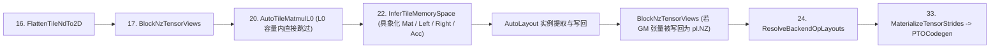

# 11. 自动布局选择 (Automatic Layout Selection)

本文档介绍 PyPTO 中自动布局选择原型 (`pypto.ir.auto_layout`) 的设计、Pass 管线位置、求解器实例提取与写回，以及代价模型标定框架。该设计基于论文 *Tensor Seeks Layout: Formalizing Layout Selection for ML Compilers* (Eisenhofer et al., arXiv:2608.21555) 的形式化模型。

---

## 1. 背景与现有机制

PyPTO 在昇腾存储层次的两个不同层级上表示数据布局：

1. **全局内存 (GM / `DDR`) 张量 (`pl.Tensor`)**：
   - `TensorLayout`：`ND`（行主序）、`DN`（列主序）、`NZ`（分形分块格式 `[..., C/c0, R/16, 16, c0]`，其中 `c0 = 32 / sizeof(dtype)`）以及 `MX_*` 块缩放格式。
2. **片上 Tile (`pl.Tile`)**：
   - `TileView(blayout, slayout, fractal)` 配合 `MemorySpace`（`Vec` / UB、`Mat` / L1、`Left` / L0A、`Right` / L0B、`Acc` / L0C、`Bias`）：
     - `ROW_MAJOR_FLAT = (row_major, none_box, 512)` / `COL_MAJOR_FLAT = (col_major, none_box, 512)`（位于 `Vec` / UB）
     - `FRACTAL_NZ = (col_major, row_major, 512)`（位于 `Mat` / L1 与 `Left` / L0A）
     - `FRACTAL_ZN = (row_major, col_major, 512)`（位于转置 `Mat` / L1 与 `Right` / L0B）
     - `FRACTAL_ACC_NZ = (col_major, row_major, 1024)`（位于 `Acc` / L0C）

在引入自动布局选择前，PyPTO 通过局部或声明式 Pass 处理布局：

| Pass | 作用 | 范围 |
|---|---|---|
| [`BlockNzTensorViews`](passes/17-block_nz_tensor_views.md) (Pass 17) | 将已声明为 `pl.NZ` 的张量改写为 5 维分块视图 `[B, C/c0, R/16, 16, c0]`，并重定位 `tile.load` / `tile.store` 坐标。 | 实现已选定的 `pl.NZ` 标注；不在 `ND` 和 `NZ` 之间做自动选择。 |
| [`InferTileMemorySpace`](passes/22-infer_tile_memory_space.md) (Pass 22) | 推导 `MemorySpace`（`Vec`、`Mat`、`Left`、`Right`、`Acc`），插入进入 L0A/L0B 的 `tile.move`，并为各存储空间赋予默认 `TileView` 布局。 | 基于算子约束的局部推导。 |
| [`ResolveBackendOpLayouts`](passes/24-resolve_backend_op_layouts.md) (Pass 24) | 在算子局部为非 `row_major` 的逐元素运算操作数插入 `tile.reshape` 或 `tile.move`，并在算子后恢复原布局。 | 单算子局部合法化。 |

---

## 2. Pass 管线位置（位于 `AutoTileMatmulL0` 与 `InferTileMemorySpace` 之后）

为了同时观测并选择 GM 张量 (`DDR`) 和片上 L1/UB/L0 Tile（`Mat`、`Vec`、`Left`、`Right`、`Acc`）的布局，布局提取与写回被放置在 **`AutoTileMatmulL0` (Pass 20) 和 `InferTileMemorySpace` (Pass 22) 之后、`ResolveBackendOpLayouts` (Pass 24) 之前**：



### 为什么选择这一管线位置？

1. **L0 Tile 在 Pass 20 / Pass 22 之后才完全具象化**：
   - 在 `AutoTileMatmulL0` (Pass 20) 与 `InferTileMemorySpace` (Pass 22) 之前，L0 (`Left`、`Right`、`Acc`) Tile 以及 `Mat -> Left` / `Mat -> Right` 的 `tile.move` 尚未在 IR 中生成。
   - 紧接在 `InferTileMemorySpace` (Pass 22) 之后，所有 GM 参数 (`DDR`)、L1/UB Tile (`Mat`、`Vec`) 以及 L0 Tile (`Left`、`Right`、`Acc`) 都已成为带有明确 `MemorySpace` 的 SSA 变量。
2. **与 `AutoTileMatmulL0` 完全解耦**：
   - 当矩阵乘尺寸直接满足 L0A (64 KiB)、L0B (64 KiB) 与 L0C (128 KiB) 容量时（例如 `64x128 @ 128x64` FP16 $\to$ FP32，每个操作数仅占 16 KiB），`AutoTileMatmulL0` 是完全的空操作 (`(m, n, k) == (M, N, K)`)。
   - 这使我们可以在完全不耦合 `AutoTileMatmulL0` / `ChooseL0Tile` 的前提下，独立评估与标定布局代价模型。
3. **在 Pass 22 之后写回 GM `pl.NZ`**：
   - 当布局写回将某个 GM `Tensor` 参数设置为 `pl.NZ` 时，在后续管线 (`run_post_layout_passes`) 开头调用一次 `BlockNzTensorViews` 即可在 `MaterializeTensorStrides` (Pass 33) 和 `PTOCodegen` 之前完成 5 维分块转换。
4. **使 `ResolveBackendOpLayouts` (Pass 24) 成为严格的空操作 (No-Op)**：
   - `LayoutCostModel` 与 `extract_layout_instance` 直接查询当前 C++ `Backend`（`pypto_core.backend.get_input_tile_layout`、`BackendHandler.get_pto_target_arch`），确保仅生成后端合法的 `OperatorConfig`（例如将 `RowMajorOps()` 限制为 `row_major`、将 `Mat -> Left/Right` 限制为合法的 MTE1 分形布局、将 `Acc -> NZ` 直接存储限制在 A2/A3 `Ascend910`）。
   - 由于写回后的每个候选 `LayoutAssignment` 均已满足 `BackendTileLayoutSpec`，下游的 `ResolveBackendOpLayouts` (Pass 24) 必然退化为无改动的空操作。

---

## 3. 形式化问题与代价模型标定

遵循 Eisenhofer 等人 (arXiv:2608.21555) 的定义，设 $G = (V, E)$ 为核函数的数据流图，其中每个算子 $o \in V$ 拥有一组允许的布局配置 $Q_o$。选择配置 $q_o \in Q_o$ 将确定：

- 每个输入操作数 $i$ 所需的布局 $\text{req}(o, i)$，
- 输出值 $t$ 产生的布局 $\text{prod}(t)$，以及
- 算子执行代价 $C^{\text{op}}_o(q_o)$。

对于任意值 $t \in \mathcal{T}$（位于 GM、L1、UB 或 L0），记 $\text{cons}(t)$ 为所有消费 $t$ 的算子所请求的**不同**布局集合。转换到每个不同布局 $\ell \in \text{cons}(t)$ 的代价仅计入一次：

$$
\min_{\{q_o \in Q_o\}} \left[
  \sum_{o \in V} R_o \cdot C^{\text{op}}_o(q_o)
  + \sum_{t \in \mathcal{T}} \sum_{\ell \in \text{cons}(t)} C^{\text{tr}}_t\bigl(\text{prod}(t), \ell\bigr)
\right]
$$

### 可标定代价项 (`LayoutCostModel`)

`LayoutCostModel` 为矩阵乘核函数的各个阶段提供了显式的周期级参数，便于直接对照模拟器或硬件实测数据进行标定：

1. **GM $\to$ L1/UB 加载代价 (`estimate_load_cost`)**：
   - `ND -> Mat` (`TLoadGm2L1Nd2nz`)：跨步 C0 行收集带宽 (`mte2_nd2nz_bytes_per_cycle`) + 每行 C0 块跨步惩罚 (`mte2_nd2nz_row_penalty_cycles`)。
   - `NZ -> Mat` (`TLoadGm2L1Nz2nz`)：连续分形突发带宽 (`mte2_nz2nz_bytes_per_cycle`)。
   - `ND -> Vec`：连续 UB 传输带宽 (`mte2_vec_bytes_per_cycle`)。
2. **L1 (`Mat`) $\to$ L0 (`Left` / `Right`) 搬运代价 (`estimate_move_cost`)**：
   - MTE1 传输 (`mte1_l1_to_l0_bytes_per_cycle`) + 当源与目标 `TileLayoutDesc` 不同时的附加布局转换惩罚 (`mte1_transpose_penalty_cycles`)。
3. **L0 Cube 矩阵乘计算代价 (`estimate_matmul_cost`)**：
   - `cube_issue_overhead_cycles + (M * N * K) / cube_macs_per_cycle`。
4. **L0C (`Acc`) $\to$ GM 存储代价 (`estimate_store_cost`)**：
   - `Acc -> ND` (`fixpipe_acc_to_nd_bytes_per_cycle`) 对比 `Acc -> NZ` (`fixpipe_acc_to_nz_bytes_per_cycle`)。
5. **转换与重排代价 (`estimate_conversion_cost`)**：
   - GM `ND <-> NZ`：`gm_pack_fixed_cycles + bytes / gm_pack_bytes_per_cycle`（可复用权重仅计一次，流式张量按调用次数 $R$ 计入）。
   - 片上 `tile.move` 布局转换：`bytes / onchip_relayout_bytes_per_cycle`。

---

## 4. 求解器与树宽诊断 (`pypto.ir.auto_layout_solver`)

`pypto.ir.auto_layout_solver` 基于 `LayoutProblemInstance` 实现了论文中的布局选择求解算法：

1. **`solve_greedy(instance, *, initial=None, config=None) -> LayoutSolverResult`**（论文第 4.1 节）：
   - 按拓扑数据流序执行贪心初始化（局部最小化算子自身代价与已就绪输入的转换代价），随后在所有可调算子 (`|Q_o| > 1`) 上执行确定性坐标下降扫描，并使用精确的增量收益计算 (`_State.gain` / `_State.apply`)。
2. **`compute_treewidth(instance) -> TreewidthStats`**：
   - 计算最小填充 (min-fill) 树分解并报告：
     - `dataflow_treewidth`：生产者-消费者数据流 DAG 的树宽（不含共享 GM 输入上的共消费者团），
     - `primal_treewidth`：完整原因子图 (primal factor graph) 的树宽（共享同一变量的算子构成团），
     - `active_primal_treewidth`：由可调算子 (`|Q_o| > 1`) 诱导的原图子图树宽，
     - `max_bag_domain_product` 与 `total_dp_states`：动态规划的精确状态空间规模 $\sum_k \prod_{u \in B_k} |Q_u|$。
3. **`solve_treewidth_dp(instance, *, config=None) -> LayoutSolverResult`**（论文第 4.2 节）：
   - 在可调原图的最小填充有根树分解上执行自底向上动态规划与自顶向下回溯重构。
   - 将每个算子的一元代价项 $\theta_u(q_u)$ 与每个共享张量的多端转换超边项 $\psi_t(q_{N(t)})$ 唯一分配给完整覆盖其作用域的最高树袋 (bag)，从而严格保证求得论文目标函数的全局最优解（包括跨越多消费者共享转换壁垒的协同翻转）。

```python
from pypto.backend import BackendType, set_backend_type
from pypto.ir.auto_layout import (
    LayoutCostModel,
    apply_layout_assignment,
    extract_layout_instance,
    run_post_layout_passes,
    run_pre_layout_passes,
)
from pypto.ir.auto_layout_solver import (
    compute_treewidth,
    solve_greedy,
    solve_treewidth_dp,
)
from pypto.pypto_core import passes

set_backend_type(BackendType.Ascend910)
with passes.PassContext([], memory_planner=passes.MemoryPlanner.PYPTO):
    # 1. 运行前序 Pass 1..22（直至 InferTileMemorySpace）
    pre_prog = run_pre_layout_passes(MatmulL0Fitting)

    # 2. 提取求解器实例（包含 GM 张量、L1 Tile、L0 Tile 及各算子）
    instance = extract_layout_instance(
        pre_prog,
        cost_model=LayoutCostModel(expected_uses=100),
        reusable_tensors={"w"},
    )

    # 3. 诊断树宽并运行求解器（贪心坐标下降或精确树宽动态规划）
    tw_stats = compute_treewidth(instance)
    greedy_res = solve_greedy(instance)
    exact_res = solve_treewidth_dp(instance)

    # 4. 将选定的布局分配写回 IR 并完成后续降级
    rewritten = apply_layout_assignment(pre_prog, exact_res.writeback_assignment())
    lowered = run_post_layout_passes(rewritten)
```

### Pass 管线接入与标定基准套件 (`auto_layout_bench`)

`ir.compile(..., layout_pass=...)` 和 `PassManager.get_strategy(..., layout_pass=...)` 支持在 `InferTileMemorySpace` 之后、`BlockNzTensorViews` / `ResolveBackendOpLayouts` 之前注入自定义 Pass（例如 `lambda: make_auto_layout_pass(exact_res.writeback_assignment())`）。

可使用以下命令枚举全部数据流一致的后端合法变体、完成端到端编译（生成 `manifest.json`、`.pto` 与运行时产物），并在昇腾 A2 (`a2a3`) 上实测与线性拟合 `LayoutCostModel`：

```bash
# 仅编译枚举全部合法变体并导出 .pto / manifest.json（无需真机）
python -m pypto.ir.auto_layout_bench --compile-only --output-dir build_output/auto_layout_calib

# 昇腾 A2 真机精度校验、性能测试与线性回归标定
python -m pypto.ir.auto_layout_bench --platform a2a3 --device 0 --rounds 100 --swimlane --output calib_results.json
```

对应的编程接口为 `compile_layout_variants(...)` 与 `fit_cost_model_from_measurements(...)` (`pypto.ir.auto_layout`)。

---

## 5. 演进路线图

- **Step 0（已完成）**：构建环境与 C++ `pypto_core` 编译配置。
- **Step 1（已完成）**：在 `InferTileMemorySpace` 之后提取求解器实例 (`extract_layout_instance`)、支持 GM (`DDR`) / L1 (`Mat`) / L0 (`Left`、`Right`、`Acc`) 布局写回 (`apply_layout_assignment`)、后端合法空间枚举，并在绕过 `AutoTileMatmulL0` 的 L0 适配矩阵乘上提供解耦的 `LayoutCostModel` 评估 (`evaluate_assignment`、`enumerate_assignments`)。
- **Step 2（已完成）**：已完成端到端变体编译导出 (`compile_layout_variants`)、`PassManager`/`ir.compile` 的 `layout_pass` 接入、昇腾 910B2 (`a2a3`) 13 用例 / 124 变体真机实测与泳道标定，以及用例内去均值差分回归 (`fit_cost_model_from_measurements`，用例内 Spearman 秩相关系数达 `+0.9222`)。
- **Step 3（已完成）**：实现贪心坐标下降求解器 (`solve_greedy`)、树宽诊断 (`compute_treewidth`) 以及精确树宽动态规划求解器 (`solve_treewidth_dp`)，并在标定套件与 `pypto-lib` 生产核函数上完成验证。
