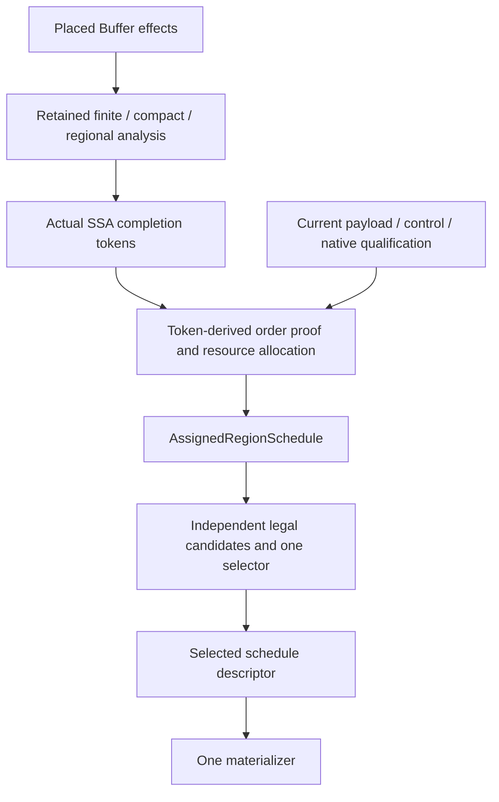

# 同步架构修正

本检查点区分已接受的架构、实现及验证证据。起点是 `868fdd471` 加上原有尚未提交的
区域调度改动；仅凭提交号不能确定该基线。此前的[区域收据](../../../en/dev/ir/regional-sync-schedules.json)
仍记录其自身测量过的实现，不能据此声称本次修正已经完成。

[修正收据](../../../en/dev/ir/sync-schedule-architecture-correction.json)记录各阶段的独立审查门槛。
阶段 1–4 已实现并在记录范围内获独立接受；主机检查与发射代码不属于设备执行证据。

## 架构与权威来源

插入从已限定的效果模型推导依赖。降低解释实际 SSA 令牌定义和使用，不得重新生成
存储需求来替换已编辑或手写的协议。原生限定（native qualification）仍必需：令牌
不证明负载管线、描述符布局、坐标准备状态、目标变体或资源保留。

分配必须区分不可变且不消耗的逻辑完成事实与会被消费的物理通知。分配给出的事件
ID、复用证明和完整调用域是调度的输入。调度不重新着色 ID、不更改令牌依赖，
不新增原生豁免，也不改变调用进入/返回保证。

不可变事务内部可以共享源程序不变的清单。独立 `LowerSync` 必须从当前程序建立
调用者事实，不能使用插入旁表或旧源快照来授权降低。

## 阶段 1：所有权、错误与限定

`CheckGeneratedLogicalSync` 将非法的插入输出报告为内部编译器错误
（internal compiler error）。独立 `InsertSync` 与事务式 `RealizeSync` 均使用该边界；
后者不能把这种错误转换为普通 PTOAS 委托。独立降低的非法用户令牌仍报告输入
验证错误。受支持的限定或资源拒绝仍保留原始函数体。

`ImportSyncPayloads` 是令牌降低的当前 IR 共享限定入口。它保留描述符检查、已放置
局部存储几何、原生指令/管线限定、坐标算术与原始槽帧检查。用于提取或原生硬件
行为限定的几何仍被检查。它不构建依赖访问清单、GM 别名划分、物理区间导出或
存储启动摘要；实际令牌顺序不从这些摘要获取存储豁免。

因此，未使用的标量形参不要求范围证书，未使用的张量形参不要求依赖模型的形状。
具有不同 GM 调用平移的受支持显式令牌程序，即使插入不能证明其访问模型关系，
也可以降低。这不证明手写协议完整，也不扩展插入的访问限定。标量定义与原生
描述符仍保留原有保守限定。

物理调度物化器（materializer）在所有阶段、余数和调用组副本之间共享一个函数所有
的命名清单。每个副本不再遍历整个原函数以保留名称。诊断计数器
`schedule_name_scans` 与 `schedule_name_visits` 将源遍历工作与发射的主体副本分开计量。

阶段 1 验证包括：

- 有未使用标量/张量参数的有限及结构化降低。
- 不同 GM 平移：独立解释实际令牌和物理标志并比较；插入仍拒绝未支持的关系。
- 生成输出的内部错误与用户输入验证错误的区分。
- 保留物理放置拒绝，以及共享命名清单的扩展性。
- 串行重建后的 153 项聚焦测试及 1,552 项广泛测试。后者有 37 条既有弃用警告。
  这些均为主机验证。

首次聚焦运行有六项 PTOAS 动态库加载失败。改用本地 PTOAS v0.72 包所要求的
Python 解释器后，最终聚焦门槛通过。收据保留该区别，不把环境失败算作编译器回归，
也不声称首次运行无条件通过。

## 阶段 2–3：独立候选与完整选择

阶段 2 将阶段准备、调用情况分组及边界命令移动规划移到物化之前。即使全部端点
覆盖整个循环，所选描述符也能按调用情况生成原循环的版本。回归在两个情况中使用
不同的实际 token 使用，并以独立访问、token 和物理旗标语义检查原始非单位步长
及不可整除的终点。该 AIV 样例向生产降级入口显式提供启动边界，不证明 AIV 调用者
事实重收集；已有 AIC 调用测试覆盖后一条独立路径。

最终重建后的阶段 2 定向门槛通过 62 项测试。诊断绑定增加及格式化之前，区域、
边界和 AIC 调用门槛通过 70 项测试，带四条既有弃用警告。审查核对了固定收据中
六个源码哈希和扩展哈希。接受范围是中间的规划/物化分离，不包括原有 B/P 准入及
局部收益策略；若基线会提取边界命令，仅情况候选仍保守留待阶段 3 的完整成本组合。

已接受设计要求先构造纯粹的已分配命令清单，再规划。候选构造不能以另一优化先
证明有收益为条件。尤其在没有有用阶段边界、也不需要周期展开时，仍须考虑调用
情况循环版本化（invocation-case loop versioning）。

有限候选目录将四种循环形式与两种分派形式交叉：

| 循环形式 | 切口内调用分派 | 调用情况循环版本化 |
| --- | --- | --- |
| 保留守卫的原始循环 | 基线 | 仅情况候选 |
| 边界分段 | 仅边界候选 | 情况 + 边界候选 |
| 周期展开 | 仅周期候选 | 情况 + 周期候选 |
| 边界分段与周期展开 | 边界 + 周期候选 | 组合候选 |

区间事实与可选的序数同余事实（ordinal congruence）分开。非单位已分配 ID 周期
不能阻止仅区间规划；仅周期规划必须保留未消除的端点守卫。规划器须保留非零
起点、正非单位步长、短/空域、余数及原始末次增量的可表示性。

一个选择器拥有完整候选成本：情况分派、谓词、循环头、坐标绑定、命令以及全部
被复制的负载/控制代码。共享谓词计算可以保留一个负载主体；循环版本化通常复制
主体，必须按复制计量。编译器 DAG 节点共享不等于发射代码共享。

增长策略必须明确。不复制策略拒绝新增负载版本；允许复制的策略必须有有限增长
预算，并在收据中说明单位及基线。所有阶段、余数和情况组均计入。强制诊断模式
只能跳过收益判断，不能跳过合法性或增长策略。不可用模式必须与成功选择恒等
调度明确区分。

阶段 3 已实现该目录及选择器。生产默认 `no_clone=True`，新增负载版本必须通过
显式诊断策略启用。启用复制后的上限是新增 4,096 个负载操作站点及 65,536 个展开
IR 节点出现次数；这是保守的编译器策略限制，不是设备校准阈值。负载扣款是精确
正增长，控制扣款计入完整保守替换上界，以零作为基线下界。因此该规则比实际新增
代码更严格，且在源序列包装被删除时仍安全。正扣款按稳定源循环顺序累计；收据
明确区分强制模式被拒绝与保留 guarded 基线。

成本扫描复用调用区间划分和物化器的作用域内标量共享规则。不支持的混合谓词
使收益保持未证明。模型统计新增源控制，不是完整函数工作量或设备周期；独立
测试检查实际轨迹和展开大小。固定的阶段 3 构建通过 136 项定向测试，其中包含
74 项独立消融、预算、回退和谓词共享检查。更广验证及默认行为变化比较属于阶段 4。

自动选择比较每种情况的完整模型控制工作；未知收益不能授权优化。恒等候选始终
保留，相同成本时依次选择更小代码、更少变换，结果须确定。模型是结构性编译
指标，不是虚构的设备校准权重，也不保证硬件加速。一个物化器只发射所选描述符，
不再进行调度规划。

## 阶段 4：独立验证

八种诊断模式必须使用相同基线和合法性/增长策略。矩阵须覆盖无阶段边界的仅情况
规划、非单位 ID 周期的仅区间规划、保留端点守卫的仅周期规划，以及强制模式的
预算拒绝。零/一/短次数、非零起点、非单位步长、尾部、情况孔洞及空情况命令清单
均需独立覆盖。

语义预言机（semantic oracle）须比较实际执行的负载身份及操作数、原始坐标和槽、
有序命令/负载轨迹、通知匹配及因果 ID 复用。候选/分配指纹可用于识别变更，但不能
替代预言机对发射 IR 的执行。

分别计量源访问、证明查询、描述符、发射负载副本、命令及标量/控制代码。独立改变
静态源规模、情况数、阶段数、周期和循环次数。每函数一次的命名清单是源遍历性质，
不意味着关系构建、边界接口或所有证明查询都具有通用 `O(N log N)` 上界；这些成本
取决于保留的关系和输出规模。

每个实现检查点必须通过独立审查后才能进入下一阶段。最终收据须区分架构接受、
源审查、已执行主机测试、发射代码测量及任何设备证据。

阶段 4 的有限验证覆盖 20 个样例、200 次策略请求。其中九个样例合计完成 110 次
具体执行比较；另十一个只测量构造，不枚举大域。基线的实际 token、访问及消费式
旗标检查建立参考，各模式保留精确有序轨迹、负载操作数和分配指纹。90 个输出通过
PTOAS C++ 生成。另用五个坐标测量保留单个负载主体的谓词共享；该发射器测量不
证明协议，也不属于情况版本化。

下表按样例请求计数，包含仅构造样例。“选中”表示全部已报告循环均选中所请求模式；
本次没有部分选中。被拒绝的请求保留明确原因和 guarded 回退。

| 请求模式 | 选中 | 不合格或拒绝 |
| --- | ---: | ---: |
| Guarded | 20 | 0 |
| Case | 6 | 14 |
| Boundary | 13 | 7 |
| Periodic | 12 | 8 |
| Case + boundary | 1 | 19 |
| Case + periodic | 0 | 20 |
| Boundary + periodic | 10 | 10 |
| Combined | 0 | 20 |

作用域实际 token 分配保留周期一限制，因此本次非平凡 case + periodic 组合不可用；
其回退输出不计为成功变换。独立诊断显式提供当前调用边界，不扩展生产调用者收集器
已有的 AIC/AIV 准入范围。

不复制默认值有意改变此前原型的取舍。以下比较具有相同序列化输入哈希且保留精确
轨迹。工作量来自独立完整函数源解释器，不是设备延迟。显式启用行使用
`no_clone=False` 及有限预算下的自动选择，不强制某个有收益结果。

| 样例与策略 | 源工作量 | C++ 字节 | C++ SET/WAIT 站点 |
| --- | ---: | ---: | ---: |
| 旋转，7 次访问：此前默认 | 141 | 13,464 | 33 |
| 旋转：新不复制默认 | 249 | 7,754 | 18 |
| 旋转：显式启用自动选择 periodic | 58 | 13,624 | 23 |
| Qwen output，H=512，layer=0/block=0：此前默认 | 43 | 17,889 | 50 |
| Qwen output：新不复制默认 | 115 | 14,992 | 26 |
| Qwen output：显式启用自动选择 boundary | 43 | 17,889 | 50 |

Qwen 的非活动 layer=1/block=19 在三种策略下均为三个工作单位。因此新默认在这些
样例中缩小静态代码，但增加活动执行的源控制工作，不能据此声称性能提升。强制
模式也可能增加工作：Qwen case-only 为 119，guarded 基线为 115；自动选择拒绝
该取舍。模型描述每次循环进入的生成控制，共有外层活动条件和负载控制不在其中。
`model_exact` 不表示精确完整调用成本；表中使用独立测得的整个函数工作量。

在已测维度中，构造保持有限。强制 boundary + periodic 时，70、7,000、1,000,000
次访问均保留三个族，检查 1,027 个描述符和 5,064 个表达式，发射 18 个负载站点、
66 条命令及 906 个展开 IR 出现次数。静态计算阶段为 1/2/4/8 时，保留族数为
3/4/6/10，展开输出为 906/1,014/1,230/1,662。调用系列保留 2/4/8/16 个情况，但只有
两个不同完整调度：始终发射两个负载版本、22 条命令，描述符访问为
598/742/1,030/1,606。该系列的空活动前缀源码也增长，不能证明任意不同调度组数
的扩展性；独立合成叶测试和源码审查覆盖较窄的分派机制。

仅两个此前默认产物匹配样例名及输入哈希，其余十八个缺失产物明确计数。阶段 4
定向测试通过 79 项，包括累计预算及序列化后的稳定源顺序选择。广泛检查执行
1,632 项：1,629 项通过，3 项因仍预期旧默认克隆形态而失败（37 条警告，546.23 秒）。
修正后的测试保留精确默认计数，显式请求专门化模式，并保留访问／轨迹、分配及
调色板拒绝检查。随后完整重跑三个受影响文件：91 项通过，24 条警告，190.61 秒。
这些修正没有更改生产代码。这是初次执行与受影响文件重跑合计覆盖的证据，不是
一次全新的广泛全通过结果；原失败日志与重跑日志均固定保留。独立审查已接受四个
日志哈希、验证活动、34 个最终代码／测试哈希、未更改的阶段 3 扩展、双语文档及
三个测试修正。接受状态详见规范 JSON 收据。

## 诊断清理检查点

原 `inspect_sync_invocation_schedules(owner, cases, trips)` 在生产选择器替换后仍保留
独立的启动控制收益规则。现删除该规则及成本累加器；重命名后的
`inspect_sync_invocation_groups(owner, cases)` 只调用共享结构分组，返回分组、描述符
数量和相等比较次数。组内谓词完整保留；该接口既不证明谓词真假，也不选择有收益的
循环变换。因此相同调度可以合为一组，即使版本化没有收益。

收益测试改为在实际 token 样例上调用 `lower_sync_schedule`，对活动取值比较完整
每次循环进入模型差值与独立执行控制工作差值。生产区间划分助手保持原有精确区间和
内部切分规则；成本统一归完整候选选择器负责。本检查点不改变生产策略、ID 映射、
token 权威或默认不复制策略。

调用者审计保留以下不同测试职责：

| 入口 | 保留职责 |
| --- | --- |
| `inspect_sync_invocation_groups` | 结构相等及区间并集分组，包括孔洞和保留谓词 |
| `emit_sync_command_cases` | 给定切点域下的共享命令分派及提取 |
| `share_sync_command_guards` | 局部有序守卫提取 |
| `materialize_sync_command_values` | 作用域内纯谓词共享，不复制载荷 |
| `emit_sync_boundary_commands` | 边界就绪／效果证明及确定性命令移动 |
| `lower_sync_schedule` | 实际 token 生产降级和完整策略选择 |
| 保留分析的 `realize_physical` 诊断 | 既有需求／映射诊断，不替代实际 token 降级 |

独立访问、token、物理旗标和标量轨迹解释器仍与编译器入口分离。上文历史收据继续
描述其固定实现，不改写为本次清理的测量结果。

## 物理实现职责

实现按所有权与决策职责拆分。以下文件均为 `src/ir/transforms/utils/` 下的私有
翻译单元（translation unit）；本次拆分保持公开入口与诊断结果形状不变。

| 文件 | 职责 |
| --- | --- |
| `physical_sync_allocation.cpp` | 使用给定顺序证明处理原生预留、可用池、通道复用和分配 |
| `physical_sync_commands.cpp` | 不可变命令描述符、精确相等、切点情况提取及局部守卫／标量共享 |
| `physical_sync_schedule.cpp` | 已分配端点清单、当前原始切点事实、候选合法性、边界证明、完整成本及函数级增长选择 |
| `physical_sync_materialization.cpp` | 安装已选择的描述符并更新复制的 SSA 名称，不选择变换或恢复分析 |
| `physical_sync_realization.cpp` | 直接／保留／调用分析集成，以及已建立的所有权或委托结果 |

两个私有头文件只包含描述符字段与函数声明；已分配清单所有者、成本模型和证明
访问器保留为实现类。物化器接收已缓存的启动表达式和已选择的切点、阶段及分组，
不能查询已分配分析所有者。一个栈上名称预留对象在同步规划／发射事务期间保持
存活，并由所有复制体共享。分配回调和端点映射保持原有所有者生命周期。谓词限定
与展开命令大小统计各自保留一份共享实现。

本次源码拆分不增加恢复 pass、缓存、公开策略或数学证明。此前验证活动和检查点
收据仍对应各自固定树；清理验证单独记录变更前后的比较。拆分后构建通过，344 项
定向测试通过（七条既有警告）。有限、轮转、作用域与 Qwen 样例的 44 个物理 IR
序列化结果逐字节相同，包括生成名称。50 个完整诊断记录完全相同；另两个拒绝
记录仅因 CHECK 移到新源码文件／行号而改变后缀，原始消息均保留。这些比较覆盖
策略收据、分配／原生映射及保留计数，不属于新的设备证据。

## 限制与参考

本次修正不更改分配器或已限定硬件契约。整核委托，以及不可用证明与已证明缺席的
区别保持不变。原生调用返回完成、设备性能及未支持的一般控制流仍是独立工作。
参见 [RealizeSync](../passes/59-realize_sync.md) 和
[逻辑流水线](../passes/60-logical_sync_pipeline.md)。

[MLIR 接口](https://mlir.llvm.org/docs/Interfaces/)提供了将操作专属语义限定与通用分析
分开的参考。[MLIR Pass 基础设施](https://mlir.llvm.org/docs/PassManagement/)提供所有权
和分析生命周期的参考。[LLVM MemorySSA](https://llvm.org/docs/MemorySSA.html)启发了
可查询的保留依赖结构，但不能替代本原型独立的开始/完成事件或会被消费的硬件资源。
[MLIR-AIR 的异步依赖流水线](https://xilinx.github.io/mlir-air/dev/AIRAsyncConcurrency/)
先将异步依赖写入 IR，再进入独立的规范化与调度阶段。它为优化前显式表示协议提供
参考，不证明 AIR 令牌与本目标标志具有相同语义。
